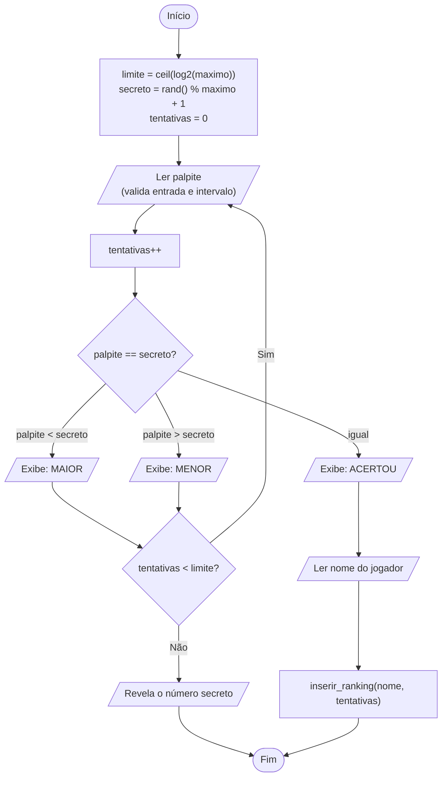
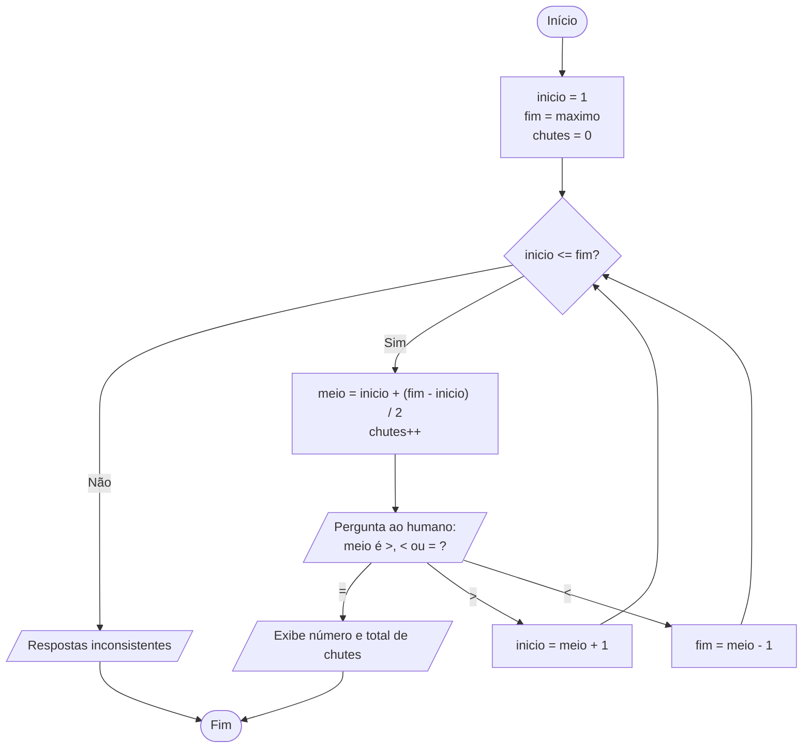
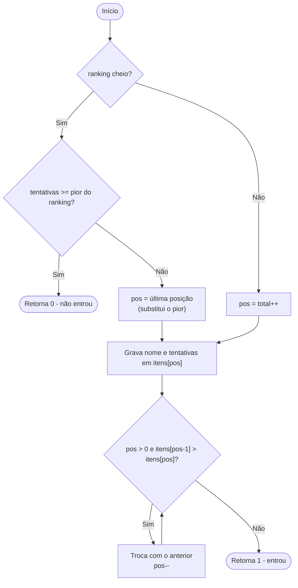

# Projeto x1 - Adivinhe o Número do Vilão

Você foi capturado pelo vilão **Cipher** (inspirado em Fallout / Mass Effect). Para escapar, precisa hackear o terminal dele adivinhando o código de acesso. O jogo tem dois modos:

1. **Jogar**: o computador sorteia um número e você tenta adivinhar, com dicas de "maior" / "menor".
2. **Modo IA**: você pensa em um número e o computador o descobre usando **busca binária**.

Há ainda um **ranking** com os 10 melhores resultados de cada dificuldade.

## Funcionalidades

| Item | Como foi feito |
|------|----------------|
| Menu principal | `switch` com: 1 Jogar, 2 Modo IA, 3 Ver ranking, 0 Sair |
| Dificuldades | Fácil (1-100), Médio (1-1000), Difícil (1-10000) |
| Limite de tentativas | `⌈log₂(máximo)⌉` → 7, 10 e 14 tentativas |
| Modo humano | `rand()` + `srand(time(NULL))`, laço `do-while`, revela o número se estourar o limite |
| Modo IA | `inicio`/`fim`, chute no meio, ajuste dos limites com `>`, `<`, `=` |
| Ranking | Vetor de `struct Jogador { char nome[50]; int tentativas; }`, sempre ordenado |
| Validação | Entradas não numéricas, lixo após o número e valores fora do intervalo não travam o jogo |

## Estrutura do código

```
projeto_x1/
├── x1.c        código-fonte (modularizado em funções)
└── README.md   este arquivo
```

Principais funções:

| Função | Responsabilidade |
|--------|------------------|
| `ler_inteiro`, `ler_no_intervalo`, `ler_resposta`, `ler_nome` | Leitura e validação de entrada |
| `limpar_buffer` | `while (getchar() != '\n')` (com proteção a `EOF`) |
| `tentativas_maximas` | Calcula `⌈log₂(n)⌉` |
| `jogar_humano` | Modo 1 |
| `jogar_ia` | Modo 2 (busca binária) |
| `inserir_ranking`, `exibir_ranking` | Ranking |
| `main` | Só o menu (bem menos de 30 linhas de lógica) |

### Estruturas de dados

- **`Jogador`**: struct exigida pelo enunciado (nome + tentativas).
- **`Ranking`**: struct com um vetor estático de 10 `Jogador` e um contador `total`. O vetor é mantido **sempre ordenado** por inserção ordenada, então exibir o ranking é apenas percorrê-lo.
- **`Nivel`**: struct com nome e valor máximo, guardada em uma tabela `const`.
- Os rankings (um por dificuldade) são variáveis **locais da `main`** e passados por ponteiro. Não há vetor global de ranking.
- **Não há alocação dinâmica**, portanto não há nada a liberar (`malloc`/`free` seriam desnecessários para um vetor fixo de 10 itens).

## Compilação e execução

Requer `gcc` (padrão C99 ou superior). Nenhuma biblioteca externa é usada: apenas `stdio.h`, `stdlib.h`, `string.h`, `time.h` e `ctype.h`.

```bash
gcc -std=c99 -Wall -Wextra -pedantic -o x1 x1.c
./x1          # Linux / macOS
x1.exe        # Windows (MinGW)
```

> O cálculo de `⌈log₂(n)⌉` é feito com inteiros (menor `t` tal que `2^t ≥ n`), por isso não é preciso linkar `-lm`.

### Como jogar o Modo IA

Pense em um número dentro do intervalo escolhido e responda a cada chute do computador:

- `>` : o seu número é **maior** que o chute
- `<` : o seu número é **menor** que o chute
- `=` : o computador **acertou**

Se as respostas forem contraditórias (ex.: não existe número possível), o programa avisa.

## Fluxogramas

### `jogar_humano` (Modo 1)



### `jogar_ia` (Modo 2 - busca binária)



### `inserir_ranking`



## Análise de Complexidade

Seja **n** o maior número possível do nível (100, 1000 ou 10000) e **k = 10** o tamanho máximo do ranking.

### 1. Qual a complexidade do Modo IA e por que ele acerta em no máximo 10 tentativas?

A cada chute, o computador descarta **metade** das possibilidades: o intervalo `[inicio, fim]` passa de tamanho `m` para no máximo `⌊m/2⌋`. Depois de `t` chutes restam no máximo `n / 2^t` candidatos, e o processo termina quando sobra 1 (ou 0). Logo:

- **Pior caso: O(log n)** chutes, mais exatamente `⌊log₂ n⌋ + 1`.
- **Melhor caso: O(1)**, quando o número está exatamente no meio.
- **Espaço: O(1)**, apenas `inicio`, `fim`, `meio` e `chutes`.

Para n = 1000: `2^10 = 1024 ≥ 1000`, portanto **no máximo 10 chutes**.

| Nível | n | `⌈log₂ n⌉` (tentativas permitidas) | Pior caso da busca binária |
|-------|---|-----------------------------------|----------------------------|
| Fácil | 100 | 7 | 7 |
| Médio | 1000 | 10 | 10 |
| Difícil | 10000 | 14 | 14 |

### 2. Por que a força bruta (chutar 1, 2, 3...) é proibida?

A força bruta (busca linear) é **O(n)**: no pior caso são **1000 chutes** no nível médio e **10000** no difícil, contra 10 e 14 da busca binária. Seria impossível respeitar o limite de `⌈log₂ n⌉` chutes. A diferença cresce muito com n: dobrar n custa apenas **+1** chute na busca binária, mas **o dobro** na linear.

### 3. Dá para o humano ganhar sempre dentro do limite?

Sim. Como o limite é exatamente `⌈log₂ n⌉` e cada dica ("maior"/"menor") permite eliminar metade do intervalo, quem usa a estratégia da busca binária **sempre** vence. O limite foi escolhido para que o jogo seja justo e recompense quem usa essa estratégia.

### 4. Complexidade do Modo Humano

| Operação | Tempo | Espaço |
|----------|-------|--------|
| Sorteio (`rand() % n + 1`) | O(1) | O(1) |
| Cada rodada (ler, comparar, dica) | O(1) | O(1) |
| Partida completa | O(log n) rodadas (limitado por `⌈log₂ n⌉`) | O(1) |

### 5. Complexidade do Ranking

O ranking é um vetor ordenado de tamanho máximo k = 10.

| Operação | Tempo | Observação |
|----------|-------|------------|
| `inserir_ranking` | O(k) | Insertion sort: no pior caso o novo item sobe todas as posições. Como k = 10 é constante, na prática **O(1)** |
| `exibir_ranking` | O(k) | Percorre o vetor, já ordenado (não precisa ordenar de novo) |
| Espaço | O(k) | `Jogador[10]` por nível, alocado na pilha |

Manter o vetor ordenado a cada inserção custa O(k) e faz a exibição ficar O(k) sem nenhum `sort` extra. Ordenar só na hora de exibir custaria O(k log k) ou O(k²) toda vez que o ranking fosse mostrado.

### 6. Complexidade da validação de entrada

`ler_inteiro` consome a linha inteira, caractere a caractere, em **O(L)**, onde L é o tamanho da linha digitada. Isso garante que o buffer sempre fique limpo para a próxima leitura, e a entrada inválida não trava o programa nem gera laço infinito (inclusive em `EOF`).

### Resumo

| Parte | Tempo | Espaço |
|-------|-------|--------|
| Modo IA (busca binária) | O(log n) | O(1) |
| Modo humano (partida) | O(log n) | O(1) |
| Inserção no ranking | O(k) ≈ O(1) | O(k) |
| Exibição do ranking | O(k) | O(1) |
